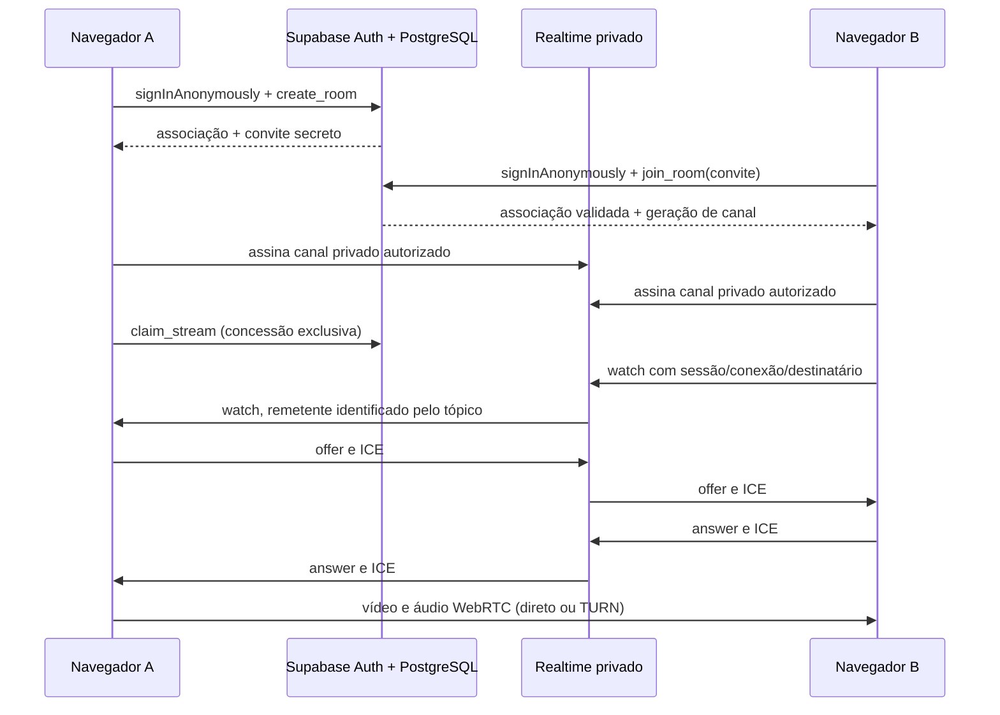

# Arquitetura e decisões

> Revisão de consumo: os intervalos e otimizações atuais estão em [DESEMPENHO.md](DESEMPENHO.md). Os prazos descritos abaixo registram o desenho inicial.

## Fluxo de confiança

Supabase nunca recebe frames ou áudio. O serviço TURN, quando necessário, encaminha mídia WebRTC criptografada. STUN não é um relay. O frontend é estático e o único serviço privilegiado opcional fora do PostgreSQL é a função de emissão TURN.

## Dados e autorização

- `rooms`: expiração, geração de canal, usuário transmissor, UUID da sessão e prazo da concessão.
- `room_members`: usuário autenticado, apelido, UUID da aba e heartbeat. Chave única por sala/usuário.
- `room_invites`: hash SHA-256 do convite e expiração. Não tem leitura pública nem por membros.
- `private.attempts`: limitador persistente por usuário para entradas/criações/emissão TURN. Retorno de erro em JSON preserva o contador mesmo em tentativas inválidas; exceções PostgreSQL fariam rollback do incremento.
- Transações bloqueiam a linha da sala para limitar capacidade e conceder um transmissor. Criação também usa advisory lock por usuário e limita três salas/hora.
- RLS permite leitura somente com associação recente e sala não expirada; nenhuma escrita direta é concedida ao cliente. Helpers privilegiados não são executáveis pelo usuário, exceto as funções de autorização necessárias às políticas.

O canal é `room:<sala>:<geração>:user:<remetente>`. Membros ativos recebem nos tópicos de membros da sala; só o dono pode publicar em seu tópico. O handler deriva a identidade do remetente a partir do canal autorizado, valida a mensagem e confere seu `client_id` contra o snapshot do banco. Não confia em `from` ou em campos arbitrários de Presence.

Ao entrar/sair ou remover membros inativos, a geração muda. Os clientes fecham tópicos antigos e assinam os atuais. Isso limita a reutilização de autorizações que o Realtime calculou na entrada do canal. A migração não presume que uma alteração de RLS revogue instantaneamente um WebSocket aberto. Mensagens que já foram recebidas não podem ser recolhidas; a atualização ocorre no próximo heartbeat de cada cliente (10 s em execução normal). O player e os peers também são reconciliados com a associação atual.

Todos os participantes com convite têm autorização de transmissão no MVP. Não existe papel moderador, expulsão, canal público, descoberta de salas ou revogação individual de convite. Use projetos separados se precisar isolar grupos mutuamente hostis. As políticas de teste não devem ser substituídas por `using (true)` em produção.

## Ciclo de mídia

Uma única chamada `getDisplayMedia()` acontece diretamente no clique do usuário, antes de qualquer RPC que consuma a ativação transitória. O stream é encerrado se a concessão exclusiva falhar. Track `ended` dispara a mesma limpeza de **Parar transmissão**.

O transmissor é sempre o único criador de ofertas. Cada espectador solicita uma conexão com UUID novo e responde à oferta. Processamento SDP é serializado; candidatos são enfileirados até `remoteDescription`. Mensagens de outra sessão, de outro client ou de uma conexão anterior são descartadas. Assim não há dois offerers concorrentes. O servidor concede apenas uma sessão de transmissão. Um Broadcast `state-changed` antecipa a leitura do estado ao iniciar/parar, limitado a uma atualização por segundo; o payload não é autoridade e o snapshot é sempre relido no servidor.

Um peer é criado por espectador, reutilizando as trilhas da mesma captura. Watch repetido não cria peer duplicado. Novos espectadores obtêm a sessão atual via heartbeat e pedem a conexão. Falhas ICE no transmissor disparam restart limitado a três tentativas por peer; espectadores que continuam sem conexão reconstruem o peer após 20 s. Uma nova sessão fecha a anterior. Sem peers, as trilhas são desativadas; ao parar ou sair, são encerradas.

Não há garantia de que reiniciar ICE resolverá NAT restritivo sem TURN. A política `VITE_ICE_TRANSPORT_POLICY=relay` permite testar o caminho TURN explicitamente; normalmente use `all`.

## Prazos e desconexões

| Evento                   | Comportamento                                                                                 |
| ------------------------ | --------------------------------------------------------------------------------------------- |
| Heartbeat                | A cada 10 s, atualiza associação e snapshot autoritativo                                      |
| Presence saiu            | Fecha o peer e limpa mídia recebida quando a ausência foi observada após presença positiva    |
| Concessão de transmissão | 35 s; apenas o heartbeat com UUID da captura ativa renova                                     |
| Backend sem responder    | HTTP tem timeout de 15 s; após 25 s sem pulse bem-sucedido, a captura/conexões são encerradas |
| Associação inativa       | Removida na reconciliação após 60 s sem heartbeat                                             |
| Sala/convite             | Expiram em 8 h, sem renovação                                                                 |
| TURN                     | Credenciais de 1 h, configuração renovada a cada 20 min                                       |
| Estatísticas             | A cada 5 s com peers; interface só recebe métricas quando o diagnóstico está habilitado       |

Depois de uma suspensão longa, o usuário pode precisar usar o convite novamente. Presença não concede associação. Uma segunda aba com a mesma identidade é recusada se usar UUID de aba diferente e a associação estiver ativa. Duplicar abas pode copiar `sessionStorage`; para duas identidades de teste, use perfis separados.

## Desempenho e limites

Captura nativa sem canvas, filtros, gravação ou análise de frames. Preferências de codec vêm de `RTCRtpReceiver.getCapabilities()` e mantêm fallbacks. O sender limita FPS, escala e teto de bitrate com parâmetros suportados; erros de aplicação desses parâmetros não bloqueiam uma negociação que o navegador consegue realizar.

`getStats()` é coletado por peer sem imprimir SDP, ICE, endereços ou tokens. Bitrate é a diferença de bytes por tempo; a primeira amostra não tem bitrate. A rota vem do par selecionado e dos tipos dos candidatos. Métricas ausentes aparecem como indisponíveis. RTT e motivo `bandwidth` do encoder orientam o teto; perdas cumulativas são exibidas, sem serem tratadas erroneamente como uma taxa de perda.

As otimizações são intenções implementadas, não medições de CPU/GPU já comprovadas. O custo do P2P cresce com os espectadores; medir em sete espectadores com um jogo exigente é condição para ajustar o perfil. O browser decide codificação e aceleração. A captura 720p30 é alvo, não promessa universal.
